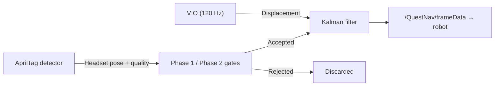

# AprilTag Tracking

QuestNav can place itself on the field with the AprilTags around it. The headset's own tracking (VIO) is
combined with tag sightings inside the app, and robot code receives the result as an ordinary field pose. This
page is an overview. The details are in:

- [Coordinate Systems](./2-coordinate-systems.md): the three coordinate systems, axis mappings and quaternion
  conventions
- [Detection Pipeline](./3-detection-pipeline.md): from camera frame to a headset pose measurement
- [Kalman Filter & Pose Estimation](./4-kalman-filter.md): the filter, the two phases, the outlier gate,
  latency compensation and recovery
- [Field Layout & Native Interop](./5-field-layout-and-native-interop.md): field layouts, custom uploads and
  the native libraries

:::info
AprilTag tracking is on by default. Turn it on or off, and tune it, in the **AprilTag** tab of the web interface.
It needs the **Headset Cameras** permission on the Quest.
:::

## Why AprilTags?

VIO gives smooth position tracking at 120 Hz, but on its own it has two limits:

1. **No absolute position.** VIO measures motion from wherever the headset started. It does not know where on
   the field that is.
2. **Drift.** Small errors add up, so the estimate slowly moves away from the truth.

Tags fix both. When the headset sees tags whose field positions it knows, it can measure its field position and
correct the drift.

## Architecture



The detector runs at the rate set in the AprilTag tab (30 fps by default) and never faster than the camera
delivers frames.

## Detection in brief

1. **Capture** a passthrough camera frame and convert it to grayscale.
2. **Detect** tag36h11 tags with libapriltag.
3. **Filter**: drop tags in the **Ignored Tag IDs** list and tags that are not in the field layout. The frame is
   used only if at least **Minimum Tags Required** tags are left.
4. **Solve** the camera pose from all tag corners at once with PoseLib, convert it to FRC field coordinates, and
   move it from the camera lens to the headset center.
5. **Check distance**: drop the frame if the average headset-to-tag distance is above **Max Tag Distance**.
6. **Fuse** it into the Kalman filter through the phase gates below.

## Two phases

### Phase 1: alignment

Until tags have placed it, the headset runs on VIO in its own frame, so its position and heading on the field
are unknown. The first frame that passes these checks aligns it:

- at least **Minimum Tags Required** tags (default 2)
- inlier ratio of at least 0.6 (the share of tag corners that fit the solved pose)

On alignment the position is set directly from the measurement and the heading offset is set from the
measured yaw. The pose's reset epoch changes and the alignment state becomes `TAG_ALIGNED`.

### Phase 2: corrections

After alignment VIO leads, and tags only correct position. A frame is used when it has:

- at least the larger of **Minimum Tags Required** and the confidence preset's tag count
- at least the preset's inlier ratio

| Preset | Tags | Inlier ratio |
|---|---|---|
| Permissive | 2 | 0.75 |
| Balanced (default) | 3 | 0.80 |
| Strict | 4 | 0.90 |
| Debug | 1 | 0.60 |

The **Debug** preset accepts single-tag solves, which can be ambiguous. Use it only for bench testing.

A frame that passes is then checked against the estimate at the moment it was captured:

- **Within 0.5 m:** always accepted.
- **Farther than 0.5 m:** accepted only if it is statistically consistent with the filter (squared
  Mahalanobis distance at most 16.27, the 99.9% level for 3 degrees of freedom) **and** no more than 2 m away.

Accepted corrections go through a normal Kalman update at capture time, and the motion since then is replayed on
top. Heading is not changed in Phase 2.

### Re-alignment

If the estimate is wrong, for example after a bad first alignment, good tag frames start failing the gate. When
**5 consecutive rejected frames** (each with 2 or more tags) agree with each other to within 0.5 m, the app
goes back to Phase 1 and reports `REALIGNING`. A frame accepted in Phase 2 resets the count.

Re-alignment needs a frame that passes both the Phase 1 checks and the preset's tag count and inlier ratio. It
then sets position and heading again and changes the reset epoch.

## Measurement noise

Each measurement's standard deviation is:

```
σ = 0.05 × noiseScale × avgTagDistance² / tagCount
```

The vertical value is doubled. `noiseScale` is the **AprilTag Trust** slider (0.5 to 2.0, default 1.0); higher
values make the filter trust tags less. Close views of many tags correct strongly, while a far view of a few tags
only nudges the estimate.

## Recenter, tracking loss and setPose

- **Recenter.** Holding the Quest button recenters the headset's tracking. The app re-expresses its history in
  the new tracking frame and adjusts the heading offset, so the field position and heading stay the same, the
  alignment state is kept and the reset epoch does not change. The app logs `VIO recenter applied`.
- **Tracking lost.** While tracking is lost, tag frames are ignored. When it comes back, a jump larger than the
  robot could have driven (6 m/s × outage + 0.25 m) is treated as a relocalization:
  - the position is held
  - the reset epoch changes
  - a headset that tags or `setPose` had placed goes back to `REALIGNING`
- **`setPose` from the robot.** Places the headset at the requested position, but uses only the **yaw** of the
  requested rotation; pitch and roll come from the headset's own gravity-aligned tracking. The alignment state
  becomes `POSE_RESET` and the reset epoch changes. The next tag frame that passes Phase 1 aligns the headset to
  the tags again.

## What gets published

The fused pose goes out on `/QuestNav/frameData` (a `ProtobufQuestNavFrameData` protobuf) on every main-loop
frame, up to 120 Hz. This happens even with the detector off, in which case it is the VIO pose. Each frame carries:

- `pose3d`: the headset pose in FRC field coordinates (meters, origin at the blue alliance corner)
- `isTracking`, `frame_count`, `timestamp`, `server_timestamp`
- `alignment_state`: `UNALIGNED`, `POSE_RESET`, `TAG_ALIGNED` or `REALIGNING`
- `reset_epoch`: changes whenever the pose is re-placed instead of following motion

QuestNavLib turns these into `PoseFrame`s. See [Robot Code](../1-getting-started/8-robot-code.mdx).

## Troubleshooting

### Position stays at the VIO origin (state `UNALIGNED`)

- **Too few tags.** Phase 1 never passed. Make sure **Minimum Tags Required** tags are in view at once.
- **Detector off or failing.** Check that the detector is enabled, the **Headset Cameras** permission is
  granted, and the log shows no camera errors.
- **Wrong layout.** Check that the selected field layout matches the field. A layout change takes effect only
  after a restart.

### Corrections are rejected

- **Check the reason.** The log names it on lines starting with `AprilTag rejected (Phase 1)` or
  `AprilTag rejected (Phase 2)`, or with `AprilTag observation rejected: avgTagDistance`.
- **Too few tags or too low inlier ratio.** Lower the preset, or lower **Minimum Tags Required**.
- **Tags too far away.** Raise **Max Tag Distance**.

### Position jumps near certain tags

- **Reflections.** Polycarbonate and shiny surfaces can show tags that aren't there. The Phase 2 gate rejects
  most of them. Add persistent bad IDs to **Ignored Tag IDs**.

### Heading is rotated

- **Bad alignment frame.** Heading comes from the Phase 1 frame and is not corrected in Phase 2. If that frame
  was bad, the position error it causes makes the gate reject good frames, and the re-alignment above sets the
  heading again. A heading error small enough to keep passing the gate stays until the next alignment.
