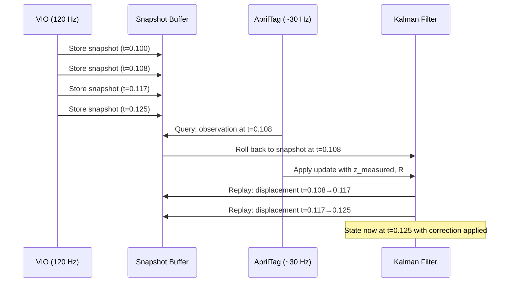

# Kalman Filter & Pose Estimation

QuestNav fuses high-rate Visual-Inertial Odometry (VIO) data from the headset with lower-rate AprilTag observations using a discrete Kalman filter with latency-compensated replay. The design is modeled after WPILib's `SwerveDrivePoseEstimator`.

## State Model

The Kalman filter operates on a **3D position** state vector in FRC field coordinates.

| Parameter | Value | Description |
|-----------|-------|-------------|
| **State vector x** | `[x, y, z]` | 3D position in meters (FRC field frame) |
| **F (state transition)** | 3×3 Identity | Prediction uses explicit displacement, not a velocity model |
| **H (observation)** | 3×3 Identity | AprilTags provide a direct position measurement |
| **Q (process noise)** | `diag(0.02², 0.02², 0.01²) × dt / (1/120 s)` | VIO displacement uncertainty, scaled by the time step `dt` (clamped to 0.1 s, except across a tracking outage) |
| **R (measurement noise)** | Dynamic | Computed per observation; see [Dynamic Measurement Noise](#dynamic-measurement-noise) |
| **P₀ (initial covariance)** | `0.001 × I` | Very high initial confidence in VIO position |

The filter does **not** estimate velocity or rotation — only position. Rotation is handled separately via a yaw offset.

## Prediction Step (120 Hz)

Called by `AddVioObservation(pose, timestamp)` every time the VIO system provides a new headset pose (120 Hz).

### Algorithm

1. **First call only**: Initialize the filter at the current VIO position (`P = 0.001 × I`, yaw offset 0) and return.

2. **Compute raw displacement**:

```
d_raw = p_vio_current - p_vio_previous
```

Both positions are in the FRC-mapped-from-Unity frame (axes are FRC-labeled but orientation depends on headset startup).

3. **Rotate displacement by yaw offset** to align with the true FRC frame:

```
        | cos(ψ)  -sin(ψ)  0 |
d_corrected =  | sin(ψ)   cos(ψ)  0 | * d_raw
        | 0        0       1 |
```

where `ψ` is the `yawOffset` computed during Phase 1 alignment.

4. **Kalman predict**:

```
x̂(k|k-1) = F * x̂(k-1|k-1)
P(k|k-1) = F * P(k-1|k-1) * Fᵀ + Q
```

5. **Apply displacement** (dead-reckoning correction):

```
x̂(k|k-1) = x̂(k|k-1) + d_corrected
```

6. **Reconstruct filter** with the corrected state (the MathNet Kalman filter does not expose state mutation, so a new instance is created).

7. **Store snapshot** in the replay buffer: `(timestamp, vioPosition, vioRotation, kfState, kfCovariance)`.

8. **Prune** snapshots older than the buffer duration (default 0.5 seconds).

## Correction Step (~30 Hz)

Called by `AddAprilTagObservation(...)` when an AprilTag observation passes confidence gating.

### Two-Phase Gating

Observations must pass phase-dependent quality gates before updating the filter.

#### Phase 1: Initial Alignment

Before any accepted AprilTag observation, the Kalman filter runs on pure VIO in an arbitrary coordinate frame. The first observation meeting the minimum quality bar establishes the field alignment. Phase 1 also runs again after a `setPose` (the next good observation re-aligns to the tags) and during [re-alignment](#re-alignment).

**Gate conditions:**
- `tagCount >= max(2, userMinimumTags)` (the **Minimum Tags Required** setting, default 2; `MIN_TAGS_FOR_POSITION_UPDATE` is the floor)
- `inlierRatio >= 0.6` (`INITIAL_ALIGNMENT_MIN_INLIER_RATIO`, not configurable)
- While re-aligning, the stricter of these and the confidence preset's values: `tagCount >= max(2, userMinimumTags, presetMinTags)` and `inlierRatio >= max(0.6, presetMinInlierRatio)`

**On accept:**
1. **Hard-reset the KF state** to the measured AprilTag position:

```
x̂ = z_measured
```

This bypass is necessary because the initial covariance `P₀ = 0.001 × I` represents extreme confidence in the VIO starting position. A standard Kalman update would compute a near-zero gain:

```
K = P * Hᵀ * (H * P * Hᵀ + R)⁻¹ ≈ 0.001 / (0.001 + R) ≈ 0.004
```

This would cause the filter to almost entirely ignore the first AprilTag measurement, keeping the headset stuck near its VIO origin.

2. **Set covariance** to the observation's measurement noise:

```
P = diag(σ_x², σ_y², σ_z²)
```

3. **Compute yaw correction** (see [Yaw Correction](#yaw-correction) below) from the VIO yaw at capture time.

4. **Re-seed the history**: snapshots older than the capture are dropped, the capture snapshot gets the new state and covariance, and the VIO motion since the capture is replayed on top.

5. Set `hasInitialAlignment = true`, change the reset epoch, and report `TAG_ALIGNED` → transition to Phase 2.

**On reject:** Observation discarded.

#### Phase 2: Confidence-Gated Corrections

After initial alignment, VIO is the primary pose source. AprilTag corrections are applied only if they meet the quality bar and agree with the estimate.

**Quality gate:**
- `tagCount >= max(2, userMinimumTags, presetMinTags)`; the **Minimum Tags Required** setting is a floor the preset cannot lower, and neither can go below 2
- `inlierRatio >= presetMinInlierRatio`

##### Confidence presets

The preset is chosen in the AprilTag tab (**Advanced**) and applies immediately.

| Preset | Value | `presetMinTags` | `presetMinInlierRatio` |
|---|---|---|---|
| Permissive | 0 | 2 | 0.75 |
| Balanced (default) | 1 | 3 | 0.80 |
| Strict | 2 | 4 | 0.90 |
| Debug | 3 | 2 | 0.60 |

The Debug preset accepts noisy solves with a low inlier ratio. It is for bench testing only. No preset accepts a single-tag solve, which can flip or misjudge depth.

**Outlier gate:** the innovation `ν = z − x̂_capture` is compared with the estimate at capture time, using `S = P_capture + R`:

```
accept if  ‖ν‖ <= 0.5 m
       or (νᵀ S⁻¹ ν <= 16.27  and  ‖ν‖ <= 2.0 m)
```

16.27 is the 99.9% chi-square quantile for 3 degrees of freedom (`CORRECTION_GATE_CHI_SQUARED`). The 0.5 m floor (`CORRECTION_GATE_MIN_DISTANCE`) keeps small, consistent biases from timestamp, extrinsic and tag placement error from being rejected when the covariance is small. The 2.0 m cap (`CORRECTION_MAX_POSITION_JUMP`) stops a large covariance, after a long stretch without tags, from admitting a wild measurement.

**On accept:** Standard KF update with latency compensation (see below). No yaw update. The re-alignment count is reset.

**On reject:** Observation discarded, and counted toward re-alignment.

#### Re-alignment

A wrong estimate (for example from a bad Phase 1 frame) makes good observations fail the outlier gate. Each rejected observation (all of them passed the quality gate, so they have at least 2 tags) is compared with the first one of the current streak:

- **Innovation within 0.5 m of the first** (`REALIGN_CONSENSUS_RADIUS`): the streak grows.
- **Otherwise:** this observation starts a new streak.

After 5 agreeing rejections (`REALIGN_REJECTION_COUNT`) the estimator drops back to Phase 1 with re-alignment pending and reports `REALIGNING`. The position keeps following VIO until a Phase 1 observation that also meets the preset is accepted.

### Standard KF Update (Phase 2)

When a Phase 2 observation is accepted:

```
K = P(k|k-1) * Hᵀ * (H * P(k|k-1) * Hᵀ + R)⁻¹
x̂(k|k) = x̂(k|k-1) + K * (z - H * x̂(k|k-1))
P(k|k) = (I - K*H) * P(k|k-1)
```

where `z` is the AprilTag-measured position and `R` is the dynamic measurement noise.

### Latency Compensation (Replay Buffer)

AprilTag observations are processed with a non-trivial delay relative to when the frame was captured. To account for this, the estimator maintains a rolling buffer of VIO snapshots and uses them to replay state corrections.

#### Algorithm

1. **Find the matching snapshot** — search backwards through the buffer for the latest snapshot with `timestamp <= aprilTagTimestamp`.

2. **If a match is found:**
   - Roll the KF state and covariance back to the snapshot's stored values
   - Apply the KF update at that historical point
   - **Replay forward**: re-apply all subsequent VIO displacements (each rotated by the current yaw offset) to bring the state to the present
   - Update each replayed snapshot's stored state in-place

3. **If no match is found** (the capture is older than the buffer, or more than 50 ms past the snapshot before it, e.g. during a tracking outage):
   - The observation is dropped, since it cannot be latency-compensated

Replay adds the process noise for each replayed step once, so the covariance after a correction matches what it would be had the observation arrived with no delay.



## Yaw Correction

The Kalman filter handles position. Yaw (heading) is corrected separately via a scalar offset. It is set at each Phase 1 alignment or re-alignment, adjusted on a recenter, and otherwise left alone.

### Computing the Yaw Offset

When the first accepted AprilTag observation arrives (Phase 1):

1. Extract the **measured yaw** from the AprilTag rotation:

```
ψ_measured = Rotation3d.Z(q_aprilTag)
```

The `.Z` component of a `Rotation3d` corresponds to rotation around the FRC Z-axis (up), which is yaw.

2. Look up the **VIO yaw at capture time** from the snapshot buffer:

```
ψ_vio = Rotation3d.Z(q_vioAtCapture)
```

3. Compute the offset:

```
yawOffset = normalize(ψ_measured - ψ_vio)
```

where `normalize` wraps the result to `[-π, π]`.

### Applying the Yaw Offset

The yaw offset is applied in two places:

1. **VIO displacements** in `AddVioObservation` and during replay — rotated by the offset before being added to the KF state.

2. **Output rotation** in `EstimatedPose`:

```
q_output = q_latestVio ∘ Rz(yawOffset)
```

where `Rz` is a rotation around the Z-axis and `∘` denotes quaternion composition.

### Why Phase 2 Does Not Update Yaw

Updating yaw from every AprilTag measurement would let noisy or wrong observations (reflections, partial occlusions) turn the heading. The headset's VIO tracks rotation with little drift, so Phase 2 corrects position only and leaves heading to VIO and to the alignments.

:::info
Only yaw (rotation around Z) is corrected. Pitch and roll pass through directly from VIO unfiltered. The Quest's IMU and VIO are sufficiently accurate for pitch and roll in FRC applications.
:::

## Dynamic Measurement Noise

The Kalman filter's R matrix is computed dynamically for each AprilTag observation, scaling the measurement noise based on observation quality.

### Formula

```
σ_linear = σ_base × noiseScale × (d_avg² / n_tags)
```

where:
- `σ_base` = 0.05 m (`MULTI_TAG_LINEAR_STD_DEV_BASE`), multiplied by the **AprilTag Trust** setting `noiseScale` (0.5 to 2.0, default 1.0)
- `d_avg` = mean distance from the headset to each tag used
- `n_tags` = number of tags used

The table below uses `noiseScale = 1.0`.

The R matrix is then:

```
R = diag(σ_linear², σ_linear², (2 × σ_linear)²)
```

The Z-axis noise is doubled because vertical position is less precisely determined by the PnP solution (tags are typically at similar heights, providing weak vertical constraints).

### Effect on Filter Behavior

| Scenario | σ\_linear | Kalman Gain | Behavior |
|----------|----------|-------------|----------|
| 3 tags at 2m | 0.067m | High | Strong correction |
| 5 tags at 3m | 0.090m | Moderate | Moderate correction |
| 2 tags at 5m | 0.625m | Low | Gentle nudge |

## Recenter Handling

When the user presses and holds the Quest logo button, the headset **recenters** the VIO tracking origin. The VIO pose jumps, and its yaw can turn, without the headset moving. Integrated as motion, that jump would corrupt the estimate.

QuestNav listens for the `OVRManager.display.RecenteredPose` event and calls `HandleRecenter()`. The anchors may not reflect the recenter yet when the event fires, so it only marks a re-base as pending. On the next VIO frame, `RebaseAfterRecenter()`:

1. Computes the frame change: `Δψ = yaw(new VIO) − yaw(last VIO)`
2. Re-expresses every snapshot's raw VIO pose in the new frame (rotated by `Δψ` about the last VIO position and moved to the new one), so replay and latency compensation keep working
3. Shifts the heading offset: `yawOffset −= Δψ`, so the published field heading does not change
4. Sets the previous VIO position and rotation to the new ones, so the step is not integrated

The KF state, covariance, alignment state and reset epoch are kept: the field pose has not changed. The app logs `VIO recenter applied: VIO yaw moved ... deg, field heading kept`. While a re-base is pending, pose resets are not latency-compensated.

## Tracking Outages

While the headset reports position tracking as lost, QuestNav stops feeding VIO to the estimator and AprilTag observations are ignored. When tracking returns, the jump between the last VIO pose before the outage and the first one after it is compared with what the robot could have driven in that time (`MAX_ROBOT_SPEED_MPS × outage + TRACKING_JUMP_MARGIN_METERS`):

- **Within the bound**, the jump is the robot's real motion during the outage and is integrated as usual. The process noise for this step covers the whole outage instead of being clamped to 0.1 s, so the covariance grows and the next AprilTag observations can correct any error the VIO picked up while it was lost.
- **Beyond the bound**, it is a relocalization. The estimate keeps its position instead of integrating the jump, the snapshot history from before it is dropped, and an estimator that was placed on the field (by AprilTags or a pose reset) drops back to Phase 1 and reports `REALIGNING`. The re-alignment needs an observation that also meets the Phase-2 confidence preset.

## Pose Reset

A pose reset (`setPose` from the robot, or **Reset Pose** in the web API) moves the VR camera root so the headset sits at the requested position with the requested **yaw**. Pitch and roll of the request are ignored: the root only turns about the vertical axis, so the headset keeps the pitch and roll its gravity-aligned tracking measures. The filter is then re-initialized at that pose (`P = 0.001 × I`, yaw offset 0, history cleared), the reset epoch changes and the state becomes `POSE_RESET`. The next observation that passes Phase 1 aligns to the tags again; it needs at least 2 tags, so a single tag never overrides the reset.

Before applying it, the app validates the pose (finite values, a non-zero quaternion) and answers an invalid one with an error response. A pose outside the loaded field layout's bounds (plus 0.25 m) is applied, but logged as a warning.

### Latency compensation

A pose reset from the robot describes where the headset was when the command was sent. When NetworkTables time is synced with the robot, QuestNav takes the command's age, looks up the raw VIO pose from that long ago in the snapshot buffer (clamped to the buffer length), and moves the target by the VIO motion since. The VIO displacement is rotated into the field by the target yaw minus the VIO yaw at that time, and the yaw change is added to the target heading. Without time sync, or for resets from the web UI, the reset is applied as received.

## Alignment State and Reset Epoch

Each published frame carries two fields that say how far the pose can be trusted:

| `AlignmentState` | When |
|---|---|
| `UNALIGNED` | Not placed on the field yet: pure VIO since startup |
| `POSE_RESET` | Placed by a pose reset, not by tags |
| `TAG_ALIGNED` | Aligned by AprilTags (Phase 2 corrections may follow) |
| `REALIGNING` | Was placed, but a relocalization or the re-alignment check invalidated it; waiting for a Phase 1 observation |

The **reset epoch** changes whenever the pose is re-placed instead of following motion: a pose reset, an AprilTag alignment or re-alignment, or a relocalization that is not integrated. It starts at a random value, wraps around, and is only meant to be compared for equality. Phase 2 corrections and recenters do not change it, although a Phase 2 correction can move the pose by up to 2 m.

## Output

The `EstimatedPose` property returns a `Pose3d` combining:

- **Position**: KF-filtered `[x, y, z]` in FRC field coordinates
- **Rotation**: Latest VIO rotation with yaw offset applied

```
EstimatedPose = Pose3d(x̂[0], x̂[1], x̂[2], q_vio ∘ Rz(yawOffset))
```

It is published in `/QuestNav/frameData` on every main-loop frame (up to 120 Hz), with the alignment state and reset epoch.

## Summary of Constants

| Constant | Value | Description |
|----------|-------|-------------|
| `defaultVioStdDevs` | 0.02, 0.02, 0.01 m | Process noise (x, y, z) per `VIO_NOISE_REFERENCE_PERIOD_SECONDS` |
| `VIO_NOISE_REFERENCE_PERIOD_SECONDS` | 1/120 s | Time step the process noise is specified for |
| `MULTI_TAG_LINEAR_STD_DEV_BASE` | 0.05 m | Base measurement noise |
| `MIN_TAGS_FOR_POSITION_UPDATE` | 2 | Hard floor on tags in one frame for any position update, in every phase and preset |
| `INITIAL_ALIGNMENT_MIN_TAGS` | 2 | Phase 1 tag minimum until the **Minimum Tags Required** setting is applied |
| `INITIAL_ALIGNMENT_MIN_INLIER_RATIO` | 0.6 | Min inlier ratio for Phase 1 |
| `CORRECTION_MIN_TAGS` | 3 | Phase 2 tags for the Balanced preset (`PRESET_*_MIN_TAGS` for the others) |
| `CORRECTION_MIN_INLIER_RATIO` | 0.8 | Phase 2 inlier ratio for the Balanced preset (`PRESET_*_MIN_INLIER_RATIO` for the others) |
| `CORRECTION_GATE_CHI_SQUARED` | 16.27 | Squared Mahalanobis limit of the outlier gate |
| `CORRECTION_GATE_MIN_DISTANCE` | 0.5 m | Innovations up to this size are always accepted |
| `CORRECTION_MAX_POSITION_JUMP` | 2.0 m | Absolute cap on an accepted innovation |
| `REALIGN_REJECTION_COUNT` | 5 | Agreeing rejections that trigger re-alignment |
| `REALIGN_CONSENSUS_RADIUS` | 0.5 m | How closely those rejections must agree |
| `BUFFER_DURATION_SECONDS` | 0.5 s | Replay buffer duration |
| `VIO_NOISE_MAX_DT_SECONDS` | 0.1 s | Longest time step process noise is added for, except across a tracking outage |
| `MAX_CAPTURE_VIO_GAP_SECONDS` | 0.05 s | Max gap between a capture and the VIO snapshot before it |
| `MAX_ROBOT_SPEED_MPS` | 6.0 m/s | Fastest plausible robot speed for the reacquire jump check |
| `TRACKING_JUMP_MARGIN_METERS` | 0.25 m | Margin on the reacquire jump check |
